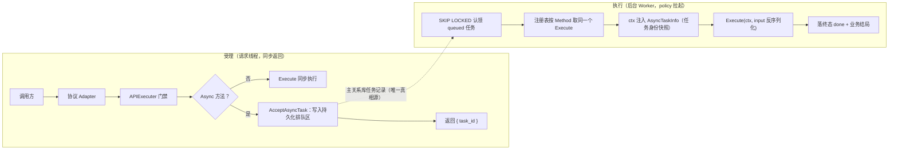
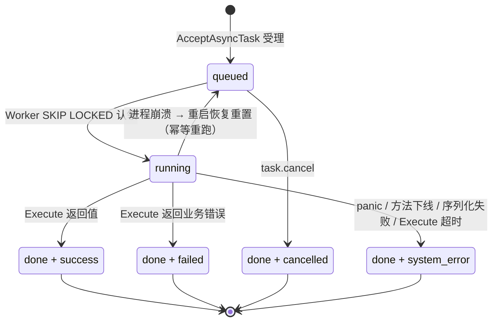

[← 返回 README](../README.md)

<!-- TOC -->

- [1. Task 域定位与边界](#1-task-域定位与边界)
- [2. 业务流转](#2-业务流转)
- [3. 方法契约](#3-方法契约)
    - [3.1. task.get](#31-taskget)
    - [3.2. task.list](#32-tasklist)
    - [3.3. task.cancel](#33-taskcancel)
    - [3.4. task.artifacts](#34-taskartifacts)
    - [3.5. task.artifact](#35-taskartifact)
- [4. 数据与并发纪律](#4-数据与并发纪律)
- [5. 验收边界](#5-验收边界)
- [6. 实现进度](#6-实现进度)

<!-- /TOC -->

# 1. Task 域定位与边界

Task 域负责异步长任务的持久状态、统一受理、后台执行与查询。主关系库（本实例 SQLite）任务记录是唯一真相源，不使用内存 channel、请求 goroutine 或连接存活状态冒充可恢复任务池。仅单 daemon 负责一个队列库，不能多实例共用本机孤儿恢复。

`SupportedMethod.Async` 只由后端方法注册设置，默认同步。受理统一收口在 `APIExecuter`：门禁通过后读取 `Async` 标识，经 `ability_task.AcceptAsyncTask` 写入持久化排队区并立即返回 `task_id`；Policy 后续按空闲名额认领任务，并按方法名调用**同一注册项的同一个 `Execute`**。`Execute` 保持纯业务工作函数，各方法不得自写受理。

# 2. 业务流转

调用流转：



状态三字段（与 model 列 comment、包内常量三处同步维护）：

| 层 | 字段 | 值域 | 唯一写方 |
|---|---|---|---|
| 程序级 | `run_status` | `queued` → `running` → `done`（唯一终态） | 调度器/Worker |
| 业务级 | `process_status` | 空（进行中）/ `success` / `failed` / `cancelled` / `system_error` | Worker 落结局、cancel 落取消 |
| 业务级 | `progress` | 0–100（`progress_message` 为伴随文案） | 业务 Execute 经 `UpdateProgress` |

两层值域零交集；`run_status=done ⟺ process_status 非空`。程序性故障（方法下线、输入/结果序列化失败、Execute panic、启用 `cli_cfg.execute_timeout_enabled` 后 `execute_timeout_seconds` 到期取消进程组、启用后的整体生命周期超时、写回不确定或重试次数用尽）落 `system_error`（单次 Execute 超时时 `error_message` 为 `task execution timed out`；整体生命周期超时时为 `task lifecycle timed out`），不新增 `process_status` 枚举；用户 `task.cancel` 仍落 `cancelled`。`Execute` 返回业务错误落 `failed`——排障时一眼分清系统坏了还是业务没通过。**部分成功**不设枚举，由业务在 result 中自描述。默认不启用执行重试次数限制，孤儿恢复仍会把崩溃后的 `running` 任务拉回 `queued` 再跑（依赖业务 `Execute` 幂等）。当 `policy_cfg.task_execute_retry_limit_enabled` 为 `true` 时，按 `task_execute_retry_limit_count` 截断：该数为首次执行之外允许的重试次数，`0` 表示不重试，不得解释为无限。调用方断线后应通过 `task.get` / `task.list` 查询已有任务，不要盲目重新提交。

状态流转：



# 3. 方法契约

受保护方法由 API 门禁统一验证凭证，身份经 context 下传；凭证来源见 [`ability_auth.md`](ability_auth.md)。本文方法签名只列业务参数，入参 schema 权威见 [`api_methods.md`](api_methods.md)。

无属主任务（Public 异步方法产生，`user_id` NULL）不可经下列方法查询或取消。

## 3.1. task.get

查询我的异步任务状态与结果。

```json
{ "task_id": "b3f11655-08df-458f-aa8d-aaa02a20bd51" }
```

- 所有权 `task.user_id == 当前用户`；任务 `done` 且有结果摘要时附 `result`（成功、失败、取消或系统错误均可，含 `job_dir` / `exit_code` / 日志路径等本机字段；这些路径不能直接当下载 URL）。

## 3.2. task.list

列出我的异步任务。

```json
{}
```

- 我的任务 id DESC，最多 50 条。

## 3.3. task.cancel

请求取消我的排队或执行中任务。

```json
{ "task_id": "b3f11655-..." }
```

- queued 原子置 done/cancelled；running 持久化 cancel_requested 并返回 cancelling，Execute/进程组退出后落 done/cancelled；终态拒绝。

## 3.4. task.artifacts

列出我的已完成任务在隔离作业目录内的可下载产物。

```json
{ "task_id": "b3f11655-08df-458f-aa8d-aaa02a20bd51" }
```

- 所有权与 `task.get` 相同。只服务已完成任务（含失败/取消/系统错误）；未完成或作业目录不可用时返回空列表。作业目录必须等于 `cli_cfg.work_root` + `task_id`，不信任载荷里的外路径。
- 只返回相对 `job_dir` 的路径（`.cif` / `.pdb` / `.json` / `.log` / `.txt`），不返回服务器绝对路径，不列出 `input/` 下的原始输入，不跟随符号链接。

## 3.5. task.artifact

读取我的已完成任务的单个产物内容。

```json
{ "task_id": "b3f11655-08df-458f-aa8d-aaa02a20bd51", "path": "output/pred.cif" }
```

- `path` 必须是 `task.artifacts` 列出的相对路径；越权、越界、符号链接、超限或非允许类型一律拒绝。
- 成功返回 `encoding=base64` 的 `content`，以及 `kind` / `size` / `content_type`。单文件上限 32MiB。

# 4. 数据与并发纪律

- **认领**：SQLite 单条条件 `UPDATE … WHERE id=(SELECT … queued … LIMIT 1) AND run_status=queued RETURNING *`，置 `running` 并 `execution_count + 1`，返回行才执行；其他行锁引擎保留事务 SKIP LOCKED（本轮未验）。8 Worker/24 任务实测每条 Execute 一次。
- **Worker 并发**：由 Policy 按 `runtime.NumCPU() × policy_cfg.workers_scaller` 计算全局上限，可用 `max_workers` 正数加绝对上限（取较小值）；每个 Worker 只认领并执行一条任务，完成后 goroutine 自然释放。
- **排队区**：受理层不设人为的每用户在途数量上限；主关系库 任务记录承载排队，资源故障按正常数据库错误返回。
- **选库与退出**：Task 使用 `storage.GormDB(ctx)` 主库；停机停止派发并取消在途 Execute，等进程组清理后关闭库。SQLite 单连接池，短生命周期锁串行认领/恢复/取消/终态转换，调度仍只有 Policy。
- 普通状态查询读已提交快照不加锁；并发状态变更一律条件原子更新或行锁事务。共享瓶颈是全局 DB 连接池（Worker 与请求线程共用），池容量属部署参数。
- **任务身份快照**：Worker 把 `AsyncTaskInfo{TaskID, UserID}` 注入 context，业务 `Execute` 经 `AsyncTaskInfoFromContext` 读取——与门禁在线身份语义分离，异步执行不要求受理时的 session 仍存活。
- **执行单元**：Policy 每轮只填充当前空闲名额，长任务持续占用其名额，下一轮不会重复扩容。
- **未尽之事自愈（取代一次性启动恢复）**：`policy` 维护大循环每轮调 `ExpireTimedOutTasks` 与 `RequeueOrphanedTasks`。默认（重试限制关闭）下，DB `running` 且不在本进程 in-flight 执行集合的孤儿任务重置回 `queued` 拉起来继续；`cancel_requested` 的孤儿仍落 `cancelled`。重启后第一轮即捞回全部死进程遗留；运行中意外孤儿同样自愈。防误拉：认领与恢复共用短生命周期锁，认领在释放锁前登记 in-flight，终态后移除。**异步 `Execute` 必须幂等或自查重**——重跑兜底依赖此契约，责任归业务函数。
- **整体超时**：由显式开关 `policy_cfg.task_lifecycle_timeout_enabled`（`true`/`false`，默认 `false`）控制。为 `false` 时忽略 `task_lifecycle_timeout_seconds`，不因耗时终止任务，也不会暗含三天或其他默认期限。为 `true` 时 `task_lifecycle_timeout_seconds` 必须是正整数（单位秒，从 `AcceptAsyncTask` 写入的 `created_at` 起算到当前时刻），`0` 或负数在配置加载时直接报错。启用后，到期的排队任务落 `done + system_error`（`error_message=task lifecycle timed out`）；执行中任务把同一截止时间交给 `Execute` 的 context，到期同样落 `system_error`。不为内部步骤另设短超时。单次 Execute 超时由 `cli_cfg.execute_timeout_enabled`（`true`/`false`，默认 `false`）控制：`false` 时忽略 `execute_timeout_seconds`，不限制单次 Execute 时长；`true` 时 `execute_timeout_seconds` 必须是正整数（秒，从本次开始执行起算），`0` 或负数在配置加载时直接报错。
- **不确定写回**：`Execute` 结束后若终态写回失败或崩溃在写回窗口，任务标记 `writeback_pending`，恢复时落 `system_error`（`execution result writeback was incomplete; not rerun`），不得当作孤儿重跑。
- **客户端断线**：请求连接断开不等于任务失败。任务在受理写入后即独立于调用连接；重连只查询已有 `task_id`，不盲目重新提交。
- **单实例边界**：不做分布式认领/租约；多实例部署是将来的独立命题。
- **载荷**：`input_payload`/`result_payload` 明文 JSON 存储；**敏感值（密码、token、密钥等）不得进入异步方法的 arguments 与结果**（门禁参数 `jwt_token` 已在受理前被 APIExecuter 移除）。持久化加密待真实敏感任务出现时另立契约。

## 4.1. 取消与恢复补充（2026-11-14）
`cancel_requested` 为持久布尔字段，不增状态枚举。queued 直接 done/cancelled；running 返回 `{cancelled:false,cancelling:true}`，由 Worker 在 Execute 和进程组清理返回后落终态。属主校验不变；非属主或无效 ID 拒绝。取消请求早于 cancel func 安装，由 Worker 重读 DB 补接。恢复时取消过的孤儿落 cancelled，其他孤儿重排。

已验 SQLite close/reopen 后恢复至 Execute；另以编译后的服务和 systemd KillMode=control-group 实测 SIGKILL 主进程、旧脚本父子进程先清理、新主进程重启后同 task_id 成功（短脚本，不是 GPU 模型）。裸运行 SIGKILL/GPU 中断恢复和完全幂等推理仍未验收。

# 5. 验收边界

真实验收必须分别证明：

- Async 方法受理立即返回 `task_id`，Worker 后续执行同一注册项 Execute。
- 多 Worker 并发认领零踩踏（SQLite UPDATE RETURNING），同一任务不被执行两次。
- 进程杀死后重启，`running` 孤儿任务被重置回 `queued` 并重跑完成。
- queued/running 属主可取消，running 等进程组清理完成才落终态；终态拒绝。
- 跨用户 `task.get` / `task.cancel` / `task.artifacts` / `task.artifact` 被所有权校验拒绝；无属主任务不可查询、取消或取件。
- 产物读取必须限制在该任务 `WorkRoot/task_id` 作业目录内；相对路径不得逃逸，不得把服务器本地路径当成下载 URL。

首个真实异步业务方法接入后完成上述端到端验收（仓内禁造演示方法）。

# 6. 实现进度

状态按 `TODO → IN_PROGRESS → DONE → ACCEPTED` 流转；发生争议时进入 `DISPUTED`，对齐后回到 `IN_PROGRESS`。只有 `ACCEPTED` 可以打勾。

本文档随模板携带：实现代码已随模板就位（DONE），真实验收须在实例化项目内按各自环境完成后方可 ACCEPTED。

- [ ] 🟡 DONE — `SupportedMethod.Async` 受理一次性接入 `APIExecuter`（api 层就此封版）。
- [ ] 🟡 DONE — 状态三字段（`run_status`/`process_status`/`progress`）落 model，枚举三处同步。
- [ ] 🟡 DONE — `AcceptAsyncTask` 受理（持久化排队 + 身份快照）。
- [ ] 🟡 DONE — Policy 按 CPU 倍率填充执行名额（SQLite 原子认领、绝对上限、临时 Worker、panic 归 system_error）。
- [ ] 🟡 DONE — 未尽之事自愈：`RequeueOrphanedTasks` 经 `policy` 维护大循环每轮侦测（in-flight 防误拉）。
- [ ] 🟡 DONE — 从模板显式移植默认关闭的整体超时与可选重试次数限制；写回不确定不重跑；断线不改变已持久化任务。保留 `cancel_requested` 与 `cli_cfg` 单次 Execute 超时（现为显式 `execute_timeout_enabled: false`）。
- [ ] 🟡 DONE — `task.get` / `task.list` / `task.cancel` 带所有权校验接入统一调用链。
- [x] ✅ ACCEPTED — `task.artifacts` / `task.artifact`：属主列出并读取隔离作业目录产物；跨用户、无凭证、伪造 `ptxk_`、输入目录、扩展名黑名单与路径穿越均拒绝。证据为隔离 HTTP fixture 短脚本，不是官方 GPU 推理取件。
- [x] ✅ ACCEPTED — Protenix v1 经真实 HTTP Bearer → SQLite → Policy → Execute → 原生小任务，产出 1 CIF；低采样烟测不是科学质量验收。
- [ ] ⬜ TODO — done 任务的归档/清理策略（保留窗口拍板后作为 `policy` 定期轮询租户实施）。
- [ ] ⬜ TODO — 任务载荷持久化加密契约（待真实敏感任务出现）。
